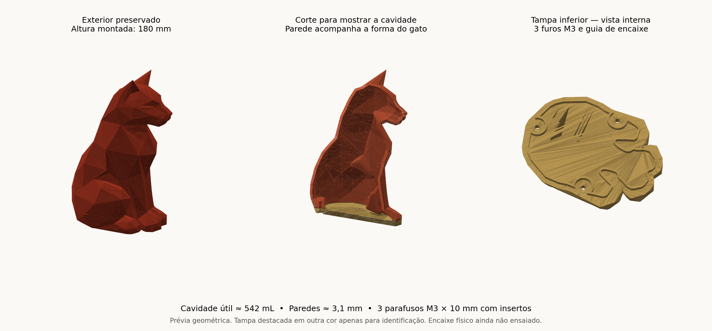

# Urna pet — gato facetado de 180 mm

Modelo com corpo oco acompanhando a forma do gato e tampa inferior com três pontos de fixação M3.

- [Baixar o 3MF com corpo e tampa](urna-pet-180mm/urna_pet_180mm_corpo_e_tampa.3mf?raw=true)
- [Baixar o pacote completo ZIP](urna-pet-180mm/urna_pet_180mm_entrega.zip?raw=true)
- [Instruções de impressão e montagem](urna-pet-180mm/LEIA-ME.txt)
- [Relatório de validação geométrica](urna-pet-180mm/validacao.json)

Altura montada: **180 mm**. Paredes nominais: **3,1 mm**. Capacidade interna aproximada: **542 mL**.

Fixação prevista: três parafusos M3 × 10 mm ISO 7380-1 com insertos térmicos M3 de 5 mm de comprimento e 4,6 mm de diâmetro externo. Confira o diâmetro de instalação recomendado pelo fabricante dos insertos.

As malhas foram verificadas geometricamente. O encaixe físico e a vedação ainda precisam de teste de impressão; o modelo não inclui junta hermética. Consulte as instruções antes de imprimir.

